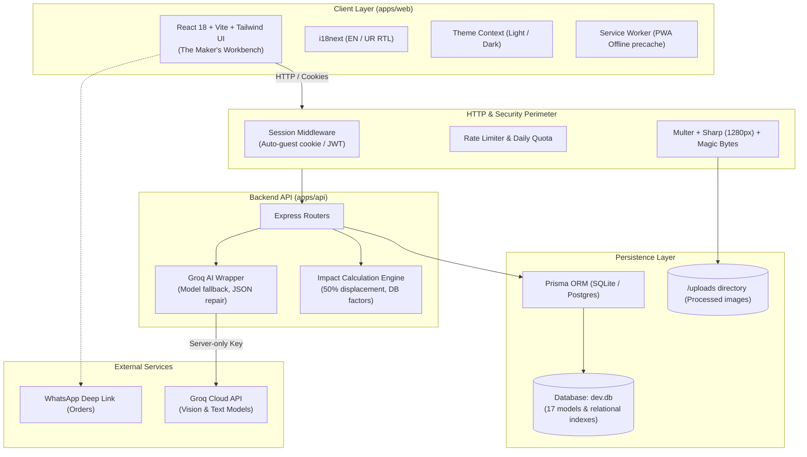
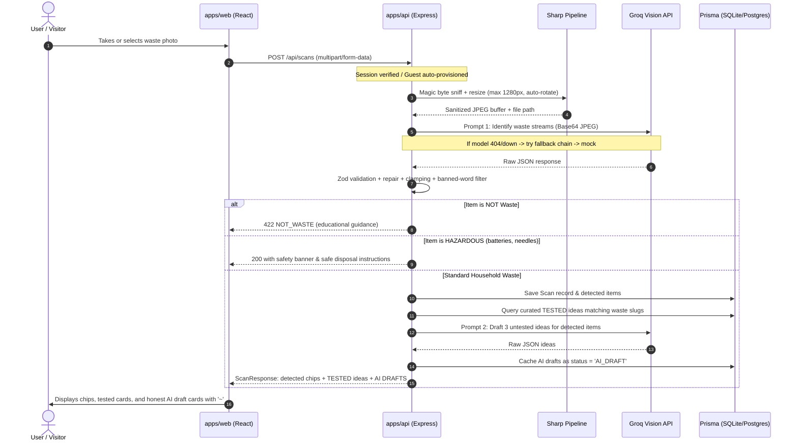

# ReMake — System Architecture & Data Flow

ReMake is an end-to-end full-stack waste-to-value web platform developed for a university sustainability course at the National University of Computer & Emerging Sciences (NUCES).

---

## 1. System Architecture

---

## 2. AI Waste Vision Data Flow

The diagram below details the exact pipeline from camera capture to honest classification:

---

## 3. Server-Only Key Isolation

A primary security constraint of ReMake is that the Groq API key is strictly server-isolated:
1. **Never Bundled**: Client-side build (`apps/web/dist`) contains zero references to `GROQ_API_KEY` or `gsk_`.
2. **Server Wrapper**: All AI operations pass through `apps/api/src/ai/client.ts` with timeout safeguards (25s), automatic retry with exponential backoff, and catalog fallback.
3. **Graceful Degradation**: If the external Groq service experiences an outage or rate limit (HTTP 429), the platform automatically falls back to curated scenarios without crashing or blocking the user experience.

---

## 4. Impact Calculation Mathematical Architecture

ReMake strictly prevents artificial hallucination of environmental metrics:
- **Server Deterministic Math**: All carbon savings and waste diverted numbers are calculated on the Express server referencing vetted database lifecycle factors.
- **Displacement Factor**: A conservative 0.5 (50%) displacement factor is applied to all estimates:
  $$\text{CO}_2\text{e Saved (kg)} = \text{Waste Weight (kg)} \times (\text{Virgin Factor} - \text{Recycled Factor}) \times 0.5$$
- **Transactional Atomic Writes**: When a maker submits a finished build ("I made this"), the make record, waste diversion log, user streaks, and badge unlock evaluations are executed within a single database transaction (`prisma.$transaction`).

